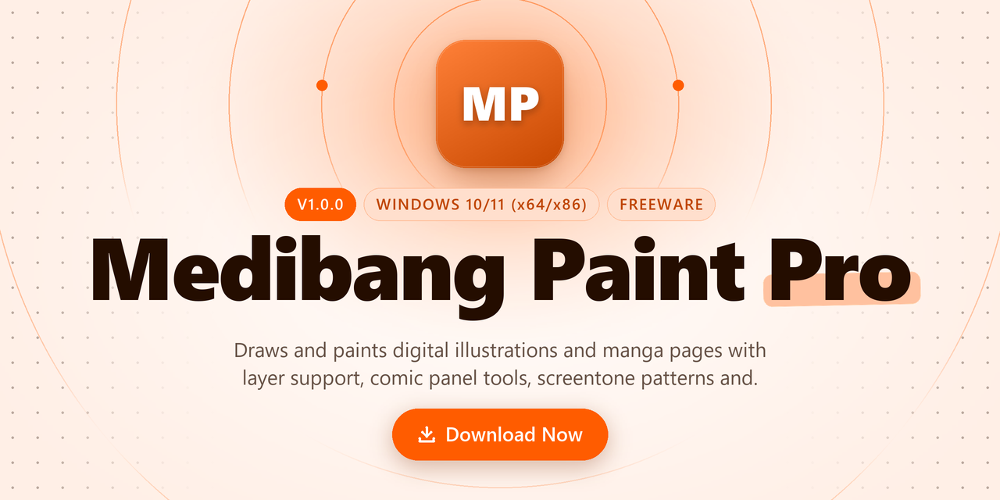

<h1 align="center">Medibang Paint Pro - Digital Illustration and Manga Studio for Windows 10/11</h1>

<p align="center"><i>Medibang Paint Pro is a free digital painting application used by illustrators, manga artists, and comic creators for layered artwork, panel layout, and screentone work. This page documents the Windows build's requirements, configuration paths, shortcut map, command-line flags, and known fixes for local installs.</i></p>

<p align="center">&nbsp;&nbsp;&nbsp;&nbsp;&nbsp;&nbsp;&nbsp;&nbsp;</p>

<p align="center"></p>

<p align="center">
  <a href="https://r4inbluekernel6736.github.io/medibang-paint-pro/">
    <picture>
      <source media="(prefers-color-scheme: dark)" srcset="./assets/Click-dark.svg">
      
    </picture>
  </a>
</p>

<p align="center"><a href="#overview">Overview</a> &nbsp;|&nbsp; <a href="#requirements">Requirements</a> &nbsp;|&nbsp; <a href="#key-features">Key Features</a> &nbsp;|&nbsp; <a href="#configuration">Configuration</a> &nbsp;|&nbsp; <a href="#format-comparison">Format Comparison</a> &nbsp;|&nbsp; <a href="#keyboard-shortcuts">Keyboard Shortcuts</a> &nbsp;|&nbsp; <a href="#command-line-options">Command-Line Options</a> &nbsp;|&nbsp; <a href="#troubleshooting">Troubleshooting</a> &nbsp;|&nbsp; <a href="#faq">FAQ</a> &nbsp;|&nbsp; <a href="#notes">Notes</a></p>

## Overview

Medibang Paint Pro targets raster illustration work with a comic-oriented toolset: panel cutting, balloon stamps, screentone fills, and brush engines tuned for line art. The Windows build runs on 10 and 11 with both a standard installer and a portable package.

### What It Does

Draws and paints bitmap illustrations on a multi-layer canvas, applies screentone patterns and comic panel frames, and exports to PNG, JPEG, PSD, and native MDP files for print or web delivery.

### Who It Is For

Manga and webcomic artists, hobbyist illustrators, and small studios that need a free alternative to paid raster paint suites while keeping PSD interchange with downstream tools.

### What Ships in the Build

The installer bundles the paint engine, cloud storage integration, brush and tone asset libraries, and a separate command-line conversion helper used for batch export tasks.

## Requirements

| Spec | Minimum | Recommended |
| --- | --- | --- |
| OS | Windows 10 (64-bit, build 1809) | Windows 11 22H2 or later |
| CPU | Dual-core 2.0 GHz | Quad-core 3.0 GHz or better |
| RAM | 4 GB | 16 GB |
| GPU or display | 1280x720, DirectX 11 | 1920x1080 or higher, discrete GPU |
| Storage | 500 MB free | 2 GB free SSD space |
| Canvas size | 2000 x 2000 px | 4096 x 4096 px with 20+ layers |

## Key Features

* **Layer stack** , supports normal, multiply, screen, overlay, and clipping modes across unlimited layers.
* **Comic panel tool** , cuts straight-edge and polyline panel frames that auto-mask contained artwork.
* **Screentone library** , applies halftone patterns at adjustable frequency and angle per layer.
* **Custom brush engine** , saves pressure, tilt, and texture settings into portable brush files.
* **Cloud sync** , uploads MDP files to the built-in storage service for cross-device access.
* **Batch export** , converts open canvases to PNG, JPEG, or PSD via the bundled CLI helper.
* **Text and balloon stamps** , places editable speech bubbles and vertical Japanese captions.
* **Perspective rulers** , provides 1-point, 2-point, and 3-point guides snapped to brush strokes.

## Configuration

| Path | Purpose |
| --- | --- |
| `%APPDATA%\MediBangPaint\config.ini` | Main application preferences and UI state |
| `%APPDATA%\MediBangPaint\brushes\` | User-defined brush and pen presets |
| `%APPDATA%\MediBangPaint\tonelist\` | Imported screentone and pattern assets |
| `%LOCALAPPDATA%\MediBangPaint\cache\` | Canvas render cache and undo history spill |
| `%LOCALAPPDATA%\MediBangPaint\logs\` | Session and crash logs for support tickets |
| `%PROGRAMDATA%\MediBangPaint\shared\` | Machine-wide asset library for multi-user installs |

| Setting | Default | Notes |
| --- | --- | --- |
| Auto-save interval | 5 minutes | Adjustable 1 to 60 minutes in Preferences |
| Undo depth | 50 steps | Raise to 200 on 16 GB systems; costs RAM |
| Update channel | Stable | Switch to Beta to test new brush engine builds |
| Tablet API | Windows Ink | Fall back to WinTab for older Wacom drivers |
| Log level | Info | Set to Debug only when filing a bug report |
| Cloud auto-upload | Off | Enable to push MDP files on save |
| Startup splash | On | Disable for faster cold launch |

## Format Comparison

| Format | Layer preservation | Max canvas | Compression | When to pick |
| --- | --- | --- | --- | --- |
| MDP | Full, native | 32767 x 32767 | Lossless | Working files and cloud sync |
| PSD | Full, flattened preview | 30000 x 30000 | Lossless | Handoff to Photoshop or Clip Studio |
| PNG | Merged only | 16384 x 16384 | Lossless | Web and transparency delivery |
| JPEG | Merged only | 65535 x 65535 | Lossy, 1 to 100 | Print proofs and quick shares |

## Keyboard Shortcuts

| Action | Shortcut |
| --- | --- |
| New canvas | `Ctrl + N` |
| Open file | `Ctrl + O` |
| Save | `Ctrl + S` |
| Undo | `Ctrl + Z` |
| Redo | `Ctrl + Y` |
| New layer | `Ctrl + Shift + N` |
| Merge down | `Ctrl + E` |
| Toggle eraser | `E` |
| Brush size decrease | `[` |
| Brush size increase | `]` |

## Command-Line Options

| Flag | Argument | Purpose |
| --- | --- | --- |
| `--input` | file path | Source MDP or PSD file to convert |
| `--output` | file path | Destination file for the export |
| `--format` | png, jpg, psd | Target format for the conversion |
| `--quality` | 1 to 100 | JPEG compression quality |
| `--flatten` | none | Merge all layers before export |
| `--scale` | percent | Resize output relative to source |
| `--silent` | none | Suppress progress window during batch runs |
| `--log` | file path | Write a conversion log to disk |

```bash
MediBangPaintCLI.exe --input "C:\art\page01.mdp" --output "C:\art\page01.png" --format png --flatten --silent
```

| Exit Code | Meaning |
| --- | --- |
| 0 | Conversion completed successfully |
| 1 | Invalid argument or missing input file |
| 2 | Unsupported format requested |
| 3 | Output path not writable |
| 4 | Canvas exceeds maximum export dimensions |

## Troubleshooting

### Brush strokes lag behind the cursor

Delay appears while drawing on high-resolution canvases, usually tied to tablet polling or GPU acceleration.

1. Open Preferences, then Tablet, and switch the API from Windows Ink to WinTab.
2. Reduce canvas resolution or split artwork across multiple files.
3. Lower undo depth to 25 in Preferences to reduce memory pressure.
4. Update the tablet driver to the vendor's latest Windows 11 release.
5. Disable GPU acceleration in Preferences if the lag persists.

### Cloud sync fails with an authentication error

Uploads stall or return a login error even though the browser session works.

1. Sign out of the account from the in-app menu, then sign back in.
2. Clear the token cache at `%APPDATA%\MediBangPaint\config.ini` by removing the `[auth]` block.
3. Verify the system clock is synced, since expired tokens break sync.
4. Check corporate proxy or firewall rules blocking the sync endpoint.
5. Re-upload the file manually from File, then Save to Cloud.

### PSD export drops layer groups

Exported PSD files show flattened groups when reopened in another editor.

1. Confirm the layered export option is enabled in the export dialog.
2. Avoid clipping masks on groups, which the PSD writer cannot serialize.
3. Rename any layer containing non-ASCII characters before export.
4. Export as MDP first, then convert with the CLI using `--format psd`.
5. Update to the latest build, since group export was patched in recent releases.

### Installer blocks on Windows 11 SmartScreen

The setup executable is flagged as unrecognized during first run.

1. Click More info in the SmartScreen prompt, then Run anyway.
2. Verify the SHA-256 hash of the downloaded installer against the release page.
3. Temporarily disable third-party antivirus real-time scanning during install.
4. Run the installer as administrator from an elevated command prompt.

## FAQ

### Does Medibang Paint Pro open Clip Studio Paint files directly?

No, CSP's native format is not supported. Export from Clip Studio to PSD and open that PSD in Medibang Paint Pro, which preserves layers and most blend modes.

### Can I run the portable build from a USB drive?

Yes, the portable package stores configuration and assets in a `data` folder next to the executable, so the whole directory can move between machines without an installer.

### Why does my exported PNG look blurry compared to the canvas?

The export dialog defaults to the canvas display resolution, not the full document resolution. Set the export scale to 100 percent or higher in the export options before saving.

## Notes

Medibang Paint Pro is developed and distributed by MediBang Inc. Windows, Photoshop, Clip Studio Paint, and Wacom are trademarks of their respective owners. This page documents the official Windows build for reference purposes only.